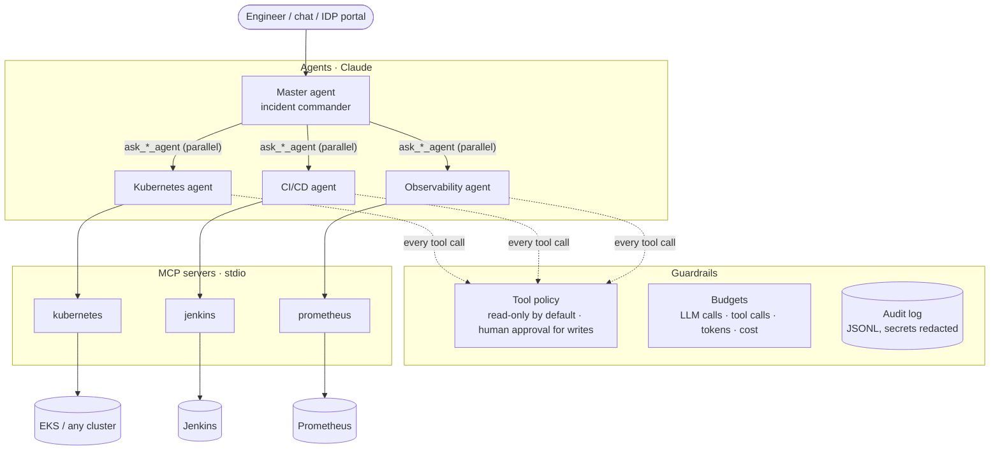

# mcp-devops-agents

[](https://github.com/pratheek888/mcp-devops-agents/actions/workflows/ci.yaml)
[](https://scorecard.dev/viewer/?uri=github.com/pratheek888/mcp-devops-agents)


A reference **multi-agent AIOps** system. A **master agent** (incident commander) breaks an
operational question into tasks and hands them **in parallel** to specialist agents for
**Kubernetes**, **CI/CD (Jenkins)** and **observability (Prometheus)**. Each specialist reaches its systems
only through **MCP servers**. **Guardrails** keep the whole thing read-only by default, budget-capped and
fully audited.

It runs end to end on **mock backends** (a scripted prod incident), so you can try it without a cluster.
Switch `DEVOPS_BACKEND=live` to point the same agents at real systems.

---

## Architecture



**Why this shape**
- **Master + specialists.** Each specialist gets a small, focused toolset and prompt, which improves tool
  choice, shrinks context and lets the master run independent investigations concurrently.
- **MCP as the integration layer.** Tools live in standard MCP servers, not inside the agent code, so the
  same servers also plug into Claude Desktop, Claude Code or any MCP client. Adding a system means adding a server.
- **Safety from tool metadata.** The policy reads each tool's MCP `readOnlyHint` annotation. Read tools
  run freely. Write tools (rollback, restart, scale, trigger build) are blocked unless the session allows
  writes, and then each call needs a human "yes".

## Quick start

```bash
git clone https://github.com/pratheek888/mcp-devops-agents && cd mcp-devops-agents
python -m venv .venv && source .venv/bin/activate
pip install -e '.[dev]'

# 1. Explore the MCP servers. No API key needed.
devops-agents tools

# 2. Investigate the built-in incident (read-only)
export ANTHROPIC_API_KEY=sk-ant-...
devops-agents demo

# 3. Same, but let the agents remediate: you approve each write
devops-agents demo --allow-writes
```

The demo scenario (`src/devops_agents/scenarios/payments-crashloop.yaml`): release **1.8.0** of
`payments-api` renamed `DB_HOST` → `PAYMENTS_DB_HOST`, but the Helm values weren't updated. Pods
crash-loop, 38% of requests fail and a downstream service degrades. To solve it, the agents need to
correlate **pod logs** (Kubernetes), the **change set and pipeline warning in build #142** (Jenkins) and the
**error rate / SLO burn** (Prometheus). With `--allow-writes` they can roll back and then confirm recovery
from metrics.

What you see while it runs:

```
master → kubernetes, cicd, observability
  kubernetes Investigate why payments-api in namespace prod is failing…
    read kubernetes.list_pods {"namespace":"prod","selector":"app=payments-api"}
    read kubernetes.get_pod_logs {"namespace":"prod","name":"payments-api-6c8f9d7b5-x2kqp"}
  cicd What was deployed for payments-api recently…
    read cicd.get_build {"job":"payments-api-deploy","number":142}
  ...
    ✗ blocked kubernetes.rollback_deployment {"namespace":"prod","deployment":"payments-api"}
```

The run ends with a structured incident report (summary, impact, root cause with confidence, timeline,
actions marked DONE / PROPOSED / BLOCKED, follow-ups), a per-agent **token and cost table**, and
`audit.jsonl`.

## Guardrails

| Control | Default | Flag |
|---|---|---|
| Write tools | blocked: the agent must recommend the command instead | `--allow-writes` |
| Approval per write | interactive `y/N` prompt | `--yes` to auto-approve (labs only) |
| Unannotated tools | treated as writes (MCP default `readOnlyHint=false`) | |
| Token budget | 400k per session | `--max-tokens` |
| Tool-call budget | 60 per session | `--max-tool-calls` |
| Tool output | truncated at 6k chars before it reaches the model | `Budget.max_tool_output_chars` |
| Audit | JSONL, one line per tool call, secrets redacted | `--audit-log` |
| Cost | estimated per agent from token usage | `Budget.price_*_per_mtok` |

Defence in depth for live use: run the servers with a **read-only Kubernetes ServiceAccount / RBAC role**
and a Jenkins user without build rights. Then the policy layer and the platform both enforce read-only.

## Use the MCP servers on their own

Each server is a normal stdio MCP server:

```bash
python -m devops_agents.servers.kubernetes
python -m devops_agents.servers.jenkins
python -m devops_agents.servers.prometheus
```

For example, in Claude Desktop or any MCP client config ([examples/mcp-config.json](examples/mcp-config.json)):

```json
{
  "mcpServers": {
    "kubernetes": {
      "command": "python",
      "args": ["-m", "devops_agents.servers.kubernetes"],
      "env": { "DEVOPS_BACKEND": "mock" }
    }
  }
}
```

## Live mode

```bash
pip install -e '.[live]'
export DEVOPS_BACKEND=live
# Kubernetes: current kubeconfig context, or in-cluster service account
export JENKINS_URL=https://jenkins.example.com JENKINS_USER=aiops-bot JENKINS_TOKEN=...
export PROMETHEUS_URL=http://prometheus.monitoring:9090
# optional: match your metric and label names
export PROM_REQUESTS_METRIC=http_requests_total PROM_SERVICE_LABEL=service PROM_STATUS_LABEL=status
devops-agents ask "Why is checkout latency up in namespace shop since 14:00?"
```

The live backends are deliberately small: the official Kubernetes client, and the Jenkins and Prometheus
HTTP APIs. The Prometheus and Jenkins clients are unit-tested against fake HTTP transports. Test against
your own systems before trusting them.

## Project layout

```
src/devops_agents/
  agents/
    master.py       incident commander: plans, delegates in parallel, writes the report
    specialist.py   tool-use loop over a specialist's MCP servers, policy + budget + audit per call
    registry.py     specialist definitions: prompt, description, which MCP servers
    guardrails.py   ToolPolicy, Budget/UsageTracker, AuditLog
    llm.py          Claude (Anthropic Messages API) behind a small interface
  servers/          MCP servers: kubernetes, jenkins, prometheus
  backends/         mock (scenario-driven) and live implementations
  scenarios/        incident fixtures for mock mode
tests/              23 tests: MCP protocol, stdio subprocesses, guardrails, orchestration
```

## Testing

```bash
pytest          # no network, no API key
ruff check src tests
```

`tests/test_orchestration.py` drives the real master → specialist → MCP server path with a **scripted
LLM**. It checks the parallel fan-out, that each specialist only sees its own tools, that a rollback is
**blocked** in read-only mode, that an **approved** rollback clears the alerts reported by a *different*
MCP server, and that budgets stop a runaway session.

## Extending

- **New system** (Argo CD, AWS, Elasticsearch, PagerDuty…): add a backend and an MCP server, mark each tool
  `READ_ONLY` / `WRITE` / `DESTRUCTIVE`, then register a `SpecialistSpec` (or give the server to an existing one).
- **New scenario**: drop a YAML file in `scenarios/` and run with `DEVOPS_SCENARIO=<name>`.
- **Different front end**: `MasterAgent.run()` is a plain async call, easy to put behind a chat UI,
  Slack bot or developer-portal endpoint.

## License

MIT
